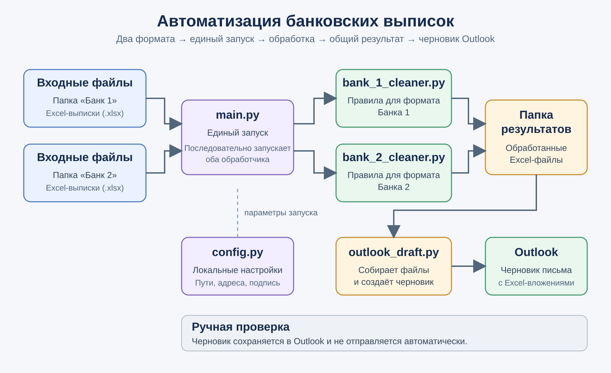

# Автоматизация банковских выписок

Практический проект автоматизации финансовой операции: обработка двух разных форматов банковских выписок, единый запуск и подготовка черновика Outlook.

## Структура проекта

```text
bank-statement-automation/
├── README.md
├── architecture.svg
├── requirements.txt
├── docs/
├── scripts/
└── test-data/
    ├── BANK1/
    ├── BANK2/
    └── qa_summary.json
```

## Архитектура проекта



Схема показывает путь от входных Excel-выписок двух форматов через единый запуск и специализированные обработчики до общей папки результатов и черновика Outlook. Черновик сохраняется для ручной проверки и автоматически не отправляется.

## Состав проекта

- `scripts/bank_1_cleaner.py` — формат Банка 1: очистка выписки с учётом объединённых ячеек.
- `scripts/bank_2_cleaner.py` — формат Банка 2: очистка выписки второго формата.
- `scripts/main.py` — последовательный запуск обоих обработчиков и предложение создать черновик.
- `scripts/outlook_draft.py` — создание черновика Outlook с Excel-файлами из общей папки результатов. Письмо не отправляется.
- `scripts/config_example.py` — образец локальной конфигурации.
- `requirements.txt` — зависимости проекта.
- `docs/testing.md` — инструкция по синтетическому тестированию.
- `test-data/` — QA-отчёты и локально создаваемые синтетические книги.

## Синтетические тесты и контроль качества

Тестовые скрипты находятся в `scripts/`: `generate_fixtures.py`, `clean_bank1.py`, `clean_bank2.py` и `verify_demo.py`. Они создают вымышленные Excel-выписки, обрабатывают их и независимо проверяют результат. Исходные и результирующие XLSX создаются локально в `test-data/BANK1/` и `test-data/BANK2/`; в Git они не сохраняются. Инструкция по тестированию: [`docs/testing.md`](docs/testing.md).

Запуск из корневой папки проекта:

```bash
python -m pip install -r requirements.txt
python scripts/generate_fixtures.py
python scripts/clean_bank1.py
python scripts/clean_bank2.py
python scripts/verify_demo.py
```

Отчёты формируются в `test-data/BANK1/qa_report.json`, `test-data/BANK2/qa_report.json` и `test-data/qa_summary.json`. В сохранённом контрольном отчёте — **23/23 PASS** (БАНК 1 — 11/11, БАНК 2 — 12/12). Это сохранённый результат предыдущего прогона; после перестройки структуры необходимо повторно выполнить команды выше.

## Установка и запуск рабочего прототипа

1. Установить зависимости рабочего прототипа: `pip install openpyxl pywin32`. Для синтетических тестов достаточно `pip install -r requirements.txt`.
2. Скопировать `scripts/config_example.py` в `scripts/config.py`.
3. Заполнить в локальном `scripts/config.py` пути, адрес отправителя, получателей и подпись.
4. Создать входные папки, указанные в настройках, и положить туда соответствующие файлы `.xlsx`.
5. Запустить `python scripts/main.py` из корневой папки проекта.
6. Проверить полученные файлы и черновик в Outlook.

## Безопасность

В публичном репозитории используются только условные обозначения и тестовые адреса-заполнители. Не публикуйте исходные выписки, реквизиты, токены, пароли, реальные адреса, локальный `scripts/config.py` или пути к рабочим папкам. Исходные книги не перезаписываются: результаты сохраняются отдельно. Черновик требует ручной проверки и не отправляется автоматически.

## Ограничения

Поддерживаются файлы `.xlsx`. Макросы, внешние связи и нестандартные элементы книг требуют отдельной проверки. Скрипты рассчитаны на две конкретные структуры выписок, а не на произвольные банковские форматы. Перед рабочим использованием протестируйте их на обезличенных копиях и проверьте каждое правило очистки.
