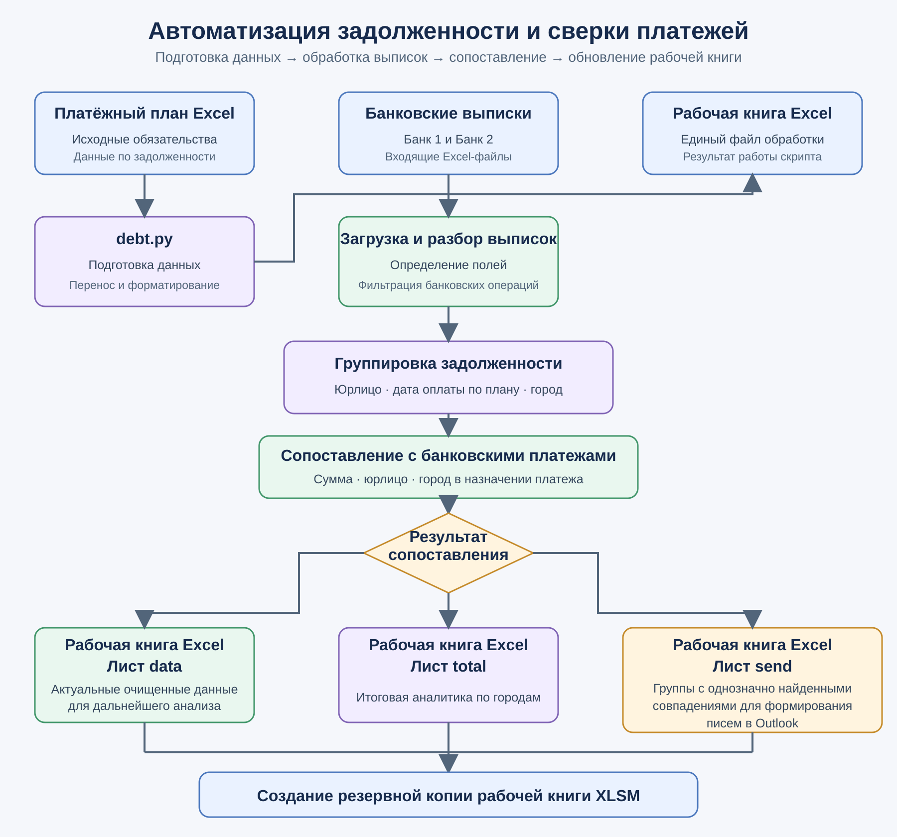

# 02. Автоматизация обработки задолженности и сверки банковских платежей

**Accounts Payable Processing & Bank Payment Reconciliation**

## Архитектура

Текстовое описание компонентов и потоков данных: [architecture_text.md](architecture_text.md).

## О проекте

Демонстрационный проект автоматизации контроля задолженности и сопоставления плановых обязательств с фактическими списаниями по банковским выпискам.

Решение объединяет данные платёжного плана и банковских выписок, группирует обязательства по заданным бизнес-ключам, ищет подтверждающие банковские операции и формирует отдельный список найденных оплат.

Проект основан на практической задаче финансового контроля. Все демонстрационные названия, идентификаторы, контрагенты и суммы — синтетические.

## Бизнес-задача

При ручной сверке специалисту необходимо сопоставлять множество строк платёжного плана с банковскими операциями, учитывать различия в форматах выписок, проверять суммы и назначение платежа, а затем отделять подтверждённые оплаты от ещё не подтверждённых обязательств.

Цель автоматизации — сократить объём ручного поиска, обеспечить воспроизводимые правила сопоставления и сохранить неоднозначные случаи для дополнительной проверки.

## Логика решения

1. Подготовить и загрузить данные платёжного плана в рабочую книгу.
2. Прочитать банковские выписки из поддерживаемых источников.
3. Определить необходимые поля выписки и отобрать операции, подходящие под заданные фильтры.
4. Сгруппировать строки плана по юридическому лицу, плановой дате и городу. Для поля города поддерживаются заголовки «Город» и прежний вариант «рс».
5. Рассчитать сумму обязательства по каждой группе.
6. Найти банковскую операцию с совпадающей суммой и подходящим городом в назначении платежа.
7. Перенести группу в отдельный реестр только при наличии ровно одного подходящего совпадения.
8. Оставить без изменения группы без совпадений и группы с неоднозначным результатом.
9. Обновить сводную информацию и журнал результатов.

**Важно:** в текущей реализации совпадение суммы проверяется по одной банковской операции. Несколько отдельных списаний не суммируются для подтверждения одной группы.

## Принципы контроля

- Неоднозначное совпадение не считается подтверждённой оплатой.
- Неподтверждённые группы остаются в исходном списке.
- Повторная обработка уже перенесённой группы не должна создавать дубликат.
- Перенос подтверждённых строк выполняется с сохранением исходной детализации.
- Перед изменением рабочей книги предусматривается резервное копирование.
- Результат должен оставаться проверяемым специалистом.

## Технологии

- Python
- openpyxl
- Excel COM / pywin32
- pathlib, datetime, decimal, re
- Excel XLSX/XLSM

## Структура проекта

- `README.md` — описание проекта и сценария использования.
- `architecture.svg` — рисунок архитектуры (первый архитектурный материал в корне).
- `architecture.md` — текстовое описание архитектуры.
- `docs/` — дополнительные материалы проекта:
  - [`docs/demo.md`](docs/demo.md) — визуальная демонстрация бизнес-сценария и результатов;
  - [`docs/algorithm.md`](docs/algorithm.md) — алгоритм и технические решения;
  - [`docs/business-process.md`](docs/business-process.md) — описание бизнес-процесса;
  - [`docs/test-results.md`](docs/test-results.md) — результаты тестового прогона.
- `scripts/` — исполняемые Python-скрипты и инструкция по их настройке.
- `test-data/` — генератор синтетических тестовых данных.

## Ограничения текущей версии

- Форматы банковских выписок могут отличаться; для каждого формата необходима проверка структуры и заголовков.
- Сопоставление по сумме и тексту назначения платежа не является универсальным доказательством платежа.
- Похожие названия городов и юридических лиц требуют строгой нормализации и тестирования.
- Автоматизация не заменяет окончательное решение и контроль финансового специалиста.
- Поддержка старого формата XLS не заявляется.

## Статус

**Основной демонстрационный сценарий успешно протестирован на синтетических данных (20.11.2026).** Проверены подготовка рабочей книги, чтение двух банковских выписок, сопоставление по сумме и городу, обработка неоднозначной группы, перенос и физическое удаление строк, обновление сводного листа и нормализация отображаемых городов. Подробности и числовые результаты приведены в [отчёте о тестировании](docs/test-results.md).

Это успешный прогон конкретного тестового набора, а не исчерпывающее тестирование всех возможных форматов выписок. Для дальнейшего использования необходимо настроить пути и параметры под собственные тестовые данные и провести дополнительные проверки.

## Конфиденциальность

В репозиторий нельзя добавлять реальные банковские выписки, исходные рабочие книги, названия организаций и банков, ИНН, номера счетов, ФИО контрагентов, адреса электронной почты, реальные суммы и иные сведения работодателя. Все примеры синтетические.
