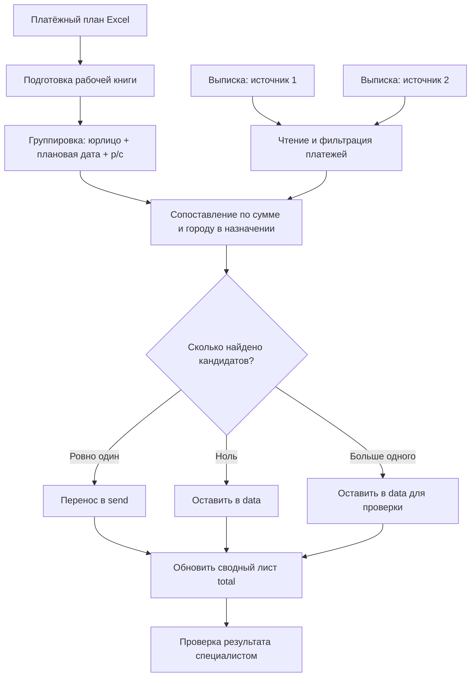

# Демонстрация проекта

## Автоматизация обработки задолженности и сверки банковских платежей

Проект сопоставляет обязательства из платёжного плана с фактическими списаниями в банковских выписках. Его задача — ускорить поиск подтверждённых оплат и при этом не скрывать случаи, требующие ручного решения.

> Демонстрация построена на полностью синтетических данных. Названия компаний, банков, контрагентов и все суммы являются тестовыми.

## Что поступает на вход

- **Платёжный план Excel** — строки обязательств с юридическим лицом, плановой датой, расчётным счётом и суммой.
- **Банковские выписки** — Excel-файлы из двух настроенных источников с операциями по списанию.

## Как работает сценарий

## Что делает алгоритм

1. Подготавливает рабочую книгу и переносит в неё строки платёжного плана.
2. Читает банковские выписки и отбирает операции по настроенным фильтрам.
3. Группирует плановые строки по юридическому лицу, плановой дате оплаты и расчётному счёту.
4. Сравнивает сумму группы с суммой одной банковской операции и проверяет город в назначении платежа.
5. Переносит группу в реестр `send`, только если найден ровно один подходящий кандидат.
6. Оставляет ненайденные и неоднозначные группы на листе `data`.
7. Обновляет сводную аналитику на листе `total`.

**Контрольное ограничение:** несколько отдельных банковских списаний не складываются для подтверждения одной группы. Дата фактического платежа может отличаться от плановой даты.

## Результат тестового прогона

<small>Фактические результаты запуска на синтетических данных 20.11.2026.</small>

| Показатель | Результат |
|---|---:|
| Банковских выписок обработано | **2** |
| Банковских платежей прошло фильтры | **6** |
| Плановых групп обработано | **6** |
| Однозначных совпадений найдено | **3** |
| Строк перенесено в `send` | **4** |
| Строк физически удалено из `data` | **4** |
| Групп без совпадения по сумме и городу | **2** |
| Неоднозначных групп оставлено на проверку | **1** |

Контрольная сумма исходного столбца L до сверки — **396 500,00**. После обработки значение `data!L1` составило **135 500,00**.

## Результаты в Excel

- **`data`** — исходные обязательства и группы, которые пока не подтверждены.
- **`send`** — строки групп с однозначно найденными платежами.
- **`total`** — сводная аналитика по городам.

В тестовом прогоне дополнительно визуально проверено, что город отображается в нормализованном виде на листах `data` и `send`.

## Технологический стек

Python · openpyxl · Excel COM · pywin32 · Excel XLSX/XLSM

## Что важно с точки зрения финансового контроля

- Неоднозначный результат не превращается автоматически в подтверждённую оплату.
- Неподтверждённые группы остаются доступными для проверки.
- Сохраняется детализация строк исходной группы.
- Автоматизация помогает специалисту, но не подменяет его контрольное решение.

## Материалы проекта

- [Архитектура решения](architecture.md)
- [Алгоритм и технические решения](algorithm.md)
- [Бизнес-процесс](business-process.md)
- [Подробный отчёт о тестировании](test-results.md)
- [Инструкция по запуску скриптов](../scripts/README.md)

## Статус и ограничения

Основной демонстрационный сценарий успешно пройден на одном синтетическом наборе. Это не означает исчерпывающего тестирования всех форматов выписок и граничных случаев. Перед эксплуатацией необходимо настроить конфигурацию и провести дополнительные проверки на тестовых данных.
